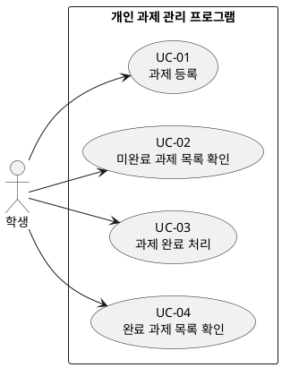

# SRS — 개인 과제 관리 프로그램 요구사항 명세서

- 문서 ID: SRS
- 팀명·팀원: WYSM / 이유찬 외 3명
- 작성일·버전: 2026-10-19 / v0.1
- 기준 고객 요구 문서·버전: `CRS_고객요구사항_초안 (2).md` / v0.1
- 상태: 초안, 고객 확인 전

> 이 명세서는 제공된 CRS를 기준으로 작성했다. CRS의 Q-01~Q-03은 실제 답변이 없어 미확정으로 유지한다. CRS가 C1, C4, C5를 언급하지만 각 ID의 별도 정의는 첨부 파일에 없으므로, 여기서는 범위 표에 적힌 설명만 반영한다.

## 1. 목적과 시스템 범위

이 프로그램은 학생이 여러 과목의 과제와 마감일을 한곳에서 관리하고, 미완료 과제를 마감일순으로 확인하며, 완료 과제와 기한이 지난 과제를 구분해 확인할 수 있도록 한다.

|구분|범위|
|---|---|
|포함|과목·과제 제목·마감일 등록, 미완료 과제의 마감일순 조회, 과제 완료 처리, 완료 과제 별도 조회, 기한이 지난 미완료 과제 보존, 잘못된 입력 안내 및 기존 데이터 보호|
|제외|로그인, 자동 알림, 학습 시스템 연동, 영구 저장, 등록 과제 수정·삭제, 완료 처리 취소|
|외부 시스템|로그인·인증 서비스, 학습 시스템, 알림 발송 서비스와 연동하지 않는다.|
|데이터 범위|프로그램 실행 중 메모리에 과제 데이터를 유지한다. 프로그램을 종료한 뒤 다시 실행하면 이전 과제 데이터는 보존되지 않는다.|

## 2. 액터

|액터|역할·사용 목적|
|---|---|
|학생(일반 사용자)|자신의 과목별 과제를 등록하고, 미완료 과제를 마감일순으로 확인하며, 완료 처리 및 완료 과제 조회를 수행한다.|

프로그램은 개인 로컬 사용을 대상으로 한다. 별도의 관리자 액터나 계정 구분은 범위에 포함하지 않는다.

## 3. 기능 요구사항

|ID|기능 요구사항|상세·처리 기준|근거 CR|우선순위|
|---|---|---|---|---|
|FR-01|과제 등록|사용자는 과목, 과제 제목, 마감일을 입력해 과제를 등록할 수 있어야 한다. 새 과제는 미완료 상태로 등록한다. 이는 미완료 목록과 완료 처리 요구에 따른 초안 가정이다.|CR-01, CR-03|1|
|FR-02|미완료 과제 조회|시스템은 미완료 과제만 마감일이 가까운 순서로 표시해야 한다. 목록에는 과목, 과제 제목, 마감일을 표시한다. 마감일이 같은 과제의 순서는 [논의] Q-01에 따른다.|CR-02|1|
|FR-03|기한 지난 과제 보존|마감일이 지난 미완료 과제도 미완료 목록에 남아 있어야 한다. 시스템은 기한 경과만으로 과제를 삭제하거나 완료 처리하지 않는다.|CR-04|2|
|FR-04|과제 완료 처리|사용자는 미완료 과제를 완료 처리할 수 있어야 한다. 완료 처리가 성공하면 과제 상태를 완료로 바꾸고 완료 과제 목록에서 조회할 수 있게 한다. 완료 취소는 제공하지 않는다.|CR-03, C5 범위 설명|2|
|FR-05|완료 과제 조회|시스템은 완료 처리된 과제를 미완료 과제와 구분해 별도 목록으로 표시해야 한다. 목록에는 과목, 과제 제목, 마감일을 표시한다.|CR-03|2|
|FR-06|입력 오류와 데이터 보호|잘못된 입력이 들어오면 시스템은 문제를 안내해야 한다. 오류가 발생해도 기존 과제 데이터는 바뀌거나 삭제되지 않아야 한다. 잘못된 날짜 입력 뒤 현재 단계에서 다시 입력을 받는 방식은 [논의] Q-02의 팀 제안이며 아직 확정되지 않았다.|CR-05|2|

## 4. 사용자 목표와 유스케이스 목록

|UC ID|유스케이스|액터|사용자 목표·이유|관련 CR / FR|
|---|---|---|---|---|
|UC-01|과제 등록|학생|과목, 과제 제목, 마감일을 기록해 과제 목록에 추가한다.|CR-01 / FR-01, FR-06|
|UC-02|미완료 과제 목록 확인|학생|아직 끝내지 않은 과제를 마감이 가까운 순서로 확인하고 기한이 지난 과제도 놓치지 않는다.|CR-02, CR-04 / FR-02, FR-03|
|UC-03|과제 완료 처리|학생|끝낸 과제를 완료 상태로 표시해 미완료 목록과 구분한다.|CR-03, CR-05 / FR-04, FR-06|
|UC-04|완료 과제 목록 확인|학생|완료한 과제를 별도로 확인한다.|CR-03 / FR-05|

### 유스케이스 다이어그램

- 다이어그램 미리보기 확인 여부: 미확인(PlantUML 렌더러를 사용하지 않음). 다이어그램은 별도 이미지 없이 PlantUML 코드로 수록했다.

## 5. 유스케이스 기술서

### UC-01 — 과제 등록

|항목|내용|
|---|---|
|목표|학생이 과목, 과제 제목, 마감일을 등록해 해야 할 일을 기록한다.|
|액터|학생|
|근거|CR-01, CR-05, FR-01, FR-06|
|사전조건|프로그램이 실행 중이다.|
|시작 사건|학생이 과제 등록을 선택한다.|
|성공 후 결과|입력된 과제가 미완료 상태로 현재 실행 세션의 목록에 추가된다.|
|실패·중단 후 결과|등록이 실패하면 새 과제는 추가되지 않고 기존 데이터는 보존된다. 프로그램을 종료하면 세션 데이터는 보존되지 않는다.|
|미확정 사항·고객 질문|[논의] Q-02 — 잘못된 입력 뒤 현재 단계에서 재입력을 받는 방식은 제안 상태다.|

#### 기본 흐름

|단계|액터의 행동|시스템의 응답|
|---|---|---|
|1|학생이 과제 등록을 선택한다.|과목, 과제 제목, 마감일 입력을 요청한다.|
|2|학생이 과목, 과제 제목, 마감일을 입력한다.|입력값을 확인한다.|
|3|학생이 등록을 요청한다.|입력값이 유효하면 과제를 미완료 상태로 현재 실행 세션에 추가한다.|
|4|학생이 등록 결과를 확인한다.|등록 성공을 안내하고 과제 목록에 반영한다.|

#### 대안·예외 흐름

|흐름 ID·구분|분기 단계·조건|액터 행동·시스템 응답|복귀 또는 종료·처리 후 결과|
|---|---|---|---|
|E1·예외|2~3단계 / 과목, 과제 제목 또는 마감일 입력이 유효하지 않음|시스템은 입력 오류를 안내한다. 오류 안내 후 현재 단계에서 다시 입력을 받는 방식은 [논의] Q-02에 따라 미확정이다.|등록을 중단하거나 재입력을 받더라도 새 과제는 추가하지 않으며 기존 과제 데이터는 보존한다.|

### UC-02 — 미완료 과제 목록 확인

|항목|내용|
|---|---|
|목표|학생이 미완료 과제를 마감일순으로 확인하고 기한이 지난 과제를 놓치지 않는다.|
|액터|학생|
|근거|CR-02, CR-04, FR-02, FR-03|
|사전조건|프로그램이 실행 중이다.|
|시작 사건|학생이 미완료 과제 목록을 선택한다.|
|성공 후 결과|현재 세션의 미완료 과제가 마감일 오름차순으로 표시된다. 기한이 지난 과제도 목록에 포함된다.|
|실패·중단 후 결과|조회가 중단되어도 과제 데이터는 변경되지 않는다.|
|미확정 사항·고객 질문|[논의] Q-01 — 마감일이 같은 과제의 정렬 기준은 미확정이며, 과목명 가나다순은 팀 제안이다.|

#### 기본 흐름

|단계|액터의 행동|시스템의 응답|
|---|---|---|
|1|학생이 미완료 과제 목록을 선택한다.|현재 세션의 미완료 과제를 조회한다.|
|2|학생이 목록을 확인한다.|과목, 과제 제목, 마감일을 마감일 오름차순으로 표시한다.|
|3|학생이 기한이 지난 과제를 확인한다.|기한이 지난 미완료 과제도 목록에 그대로 표시한다. 자동 삭제나 완료 처리는 하지 않는다.|

#### 대안·예외 흐름

|흐름 ID·구분|분기 단계·조건|액터 행동·시스템 응답|복귀 또는 종료·처리 후 결과|
|---|---|---|---|
|A1·대안|2단계 / 미완료 과제가 없음|시스템은 표시할 미완료 과제가 없음을 안내한다.|목록 확인을 종료한다. 데이터는 변경되지 않는다.|
|A2·대안|2단계 / 과제의 마감일이 동일함|시스템은 [논의] Q-01에 따라 정해질 기준으로 같은 마감일의 과제를 정렬한다. 현재 팀 제안은 과목명 가나다순이다.|목록을 계속 표시한다. 기준 확정 전에는 동률 과제 간 순서를 요구사항으로 고정하지 않는다.|

### UC-03 — 과제 완료 처리

|항목|내용|
|---|---|
|목표|학생이 끝낸 과제를 완료 표시하여 미완료 과제와 구분한다.|
|액터|학생|
|근거|CR-03, CR-05, FR-04, FR-06|
|사전조건|프로그램이 실행 중이고 완료 처리할 과제가 미완료 상태로 등록되어 있다.|
|시작 사건|학생이 미완료 과제 목록에서 완료할 과제를 선택한다.|
|성공 후 결과|선택한 과제가 완료 상태가 되어 완료 과제 목록에 나타나며, 미완료 목록에서는 제외된다.|
|실패·중단 후 결과|완료 처리가 실패하면 과제 상태는 미완료로 유지되고 기존 데이터는 보존된다.|
|미확정 사항·고객 질문|잘못된 과제 선택 뒤 어느 화면으로 돌아갈지는 CRS에서 정하지 않았다. CRS Q-02는 날짜 형식 오류의 재입력 경로에 관한 질문이다. [논의] Q-03 — 완료 실수에 대한 구제책은 첫 구현에서 제공하지 않는 팀 제안이며 실제 답변은 없다.|

#### 기본 흐름

|단계|액터의 행동|시스템의 응답|
|---|---|---|
|1|학생이 미완료 과제 목록에서 완료할 과제를 선택한다.|선택한 과제와 현재 상태를 표시한다.|
|2|학생이 완료 처리를 요청한다.|선택한 과제를 완료 상태로 변경한다.|
|3|학생이 처리 결과를 확인한다.|완료 처리 성공을 안내하고 미완료 목록과 완료 목록에 변경된 상태를 반영한다.|

#### 대안·예외 흐름

|흐름 ID·구분|분기 단계·조건|액터 행동·시스템 응답|복귀 또는 종료·처리 후 결과|
|---|---|---|---|
|E1·예외|1~2단계 / 잘못된 과제를 선택했거나 완료 처리 입력이 유효하지 않음|시스템은 문제를 안내한다. 잘못된 과제 선택 뒤 어느 화면으로 돌아갈지는 CRS에서 정하지 않았다.|완료 처리하지 않고 과제 데이터와 상태를 보존한다.|
|E2·예외|2단계 이후 / 완료 처리 실수를 정정하려 함|완료 취소 기능은 범위에서 제외되어 있어 시스템은 상태를 미완료로 되돌리지 않는다. 예외 구제책은 [논의] Q-03이다.|과제는 완료 상태로 유지한다. 첫 구현에는 복구 기능이 없다.|

### UC-04 — 완료 과제 목록 확인

|항목|내용|
|---|---|
|목표|학생이 완료 처리한 과제를 별도로 확인한다.|
|액터|학생|
|근거|CR-03, FR-05|
|사전조건|프로그램이 실행 중이다.|
|시작 사건|학생이 완료 과제 목록을 선택한다.|
|성공 후 결과|현재 세션의 완료 과제가 별도 목록으로 표시된다.|
|실패·중단 후 결과|조회가 중단되어도 과제 데이터는 변경되지 않는다.|
|미확정 사항·고객 질문|없음|

#### 기본 흐름

|단계|액터의 행동|시스템의 응답|
|---|---|---|
|1|학생이 완료 과제 목록을 선택한다.|현재 세션에서 완료 상태인 과제를 조회한다.|
|2|학생이 목록을 확인한다.|과목, 과제 제목, 마감일을 표시한다.|

#### 대안·예외 흐름

없음.

## 6. 데이터와 상태 규칙

|데이터·상태|정의·규칙|
|---|---|
|과목|과제가 속한 과목명이다.|
|과제 제목|사용자가 등록하는 과제의 제목이다.|
|마감일|과제의 마감일이다. 과제 목록은 이 값을 기준으로 오름차순 정렬한다.|
|미완료|등록 직후의 기본 상태이자, 완료 처리 전의 상태다. 등록 직후 미완료 상태는 초안 가정이다.|
|완료|학생이 완료 처리를 수행한 상태다. 완료 목록에서 별도로 조회한다. 완료 취소는 지원하지 않는다.|
|기한 경과|마감일이 지났지만 완료되지 않은 상태다. 별도 상태로 자동 변경하지 않으며 미완료 목록에 계속 남긴다.|
|동일 마감일 정렬|과목명 가나다순을 팀이 제안했으나 고객 답변이 없어 확정되지 않았다. [논의] Q-01|
|데이터 수명|과제 데이터는 프로그램 실행 중에만 유지한다. 프로그램 종료 후 영구 저장하지 않는다.|

## 7. 비기능 요구사항과 제약

|ID|요구사항·제약|확인 기준|근거|
|---|---|---|---|
|NFR-01|개인 로컬 프로그램으로 동작하며 로그인, 자동 알림, 학습 시스템 연동을 제공하지 않는다.|별도 계정·인증·알림·학습 시스템 연동 없이 과제 등록과 조회가 가능하다.|CRS 개발 범위, NEEDS_7, C1, C4 참조|
|NFR-02|과제 데이터는 실행 중에만 유지하고 영구 저장하지 않는다.|프로그램 실행 중 등록·완료 상태가 조회되며 종료 후에는 데이터가 남지 않는다.|CRS 개발 범위, C5 참조|
|NFR-03|잘못된 입력은 기존 과제 데이터를 손상시키지 않아야 한다.|잘못된 입력을 처리한 뒤 기존 항목과 상태가 입력 전과 동일하다.|CR-05, FR-06|

## 8. 요구사항 추적표

|CRS 요구사항|SRS 기능 요구사항|유스케이스|추적 상태·비고|
|---|---|---|---|
|CR-01 과목·과제 제목·마감일 등록|FR-01, FR-06|UC-01|반영|
|CR-02 미완료 과제를 마감일순 조회|FR-02|UC-02|반영. 동률 정렬 기준은 Q-01 미확정|
|CR-03 완료 처리 및 완료 목록 별도 조회|FR-04, FR-05|UC-03, UC-04|반영. 완료 취소는 제외 범위|
|CR-04 기한 지난 미완료 과제 보존|FR-03|UC-02|반영|
|CR-05 잘못된 입력 안내와 기존 데이터 보호|FR-06|UC-01, UC-03|반영. 오류 후 재입력 방식은 Q-02 미확정|

## 9. 고객 확인 사항

|Q ID|확인이 필요한 질문|영향 범위|팀 제안|고객 답변·상태|
|---|---|---|---|---|
|Q-01|마감일이 동일한 과제가 여러 개일 경우 어떤 순서로 정렬할까요?|FR-02, UC-02|과목명 가나다순으로 정렬한다.|답변 없음 / 미확인|
|Q-02|잘못된 형식의 날짜를 입력하면 오류 안내 후 현재 단계에서 다시 입력받을까요, 아니면 메인 메뉴로 돌아갈까요?|FR-06, UC-01|오류 메시지를 보여주고 현재 단계에서 다시 입력받는다.|답변 없음 / 미확인|
|Q-03|실수로 완료 처리한 과제를 되돌리는 기능이 제외되어 있는데, 별도 구제책을 마련할까요?|FR-04, UC-03|첫 구현에서는 구제책을 제공하지 않고 후속 개선으로 검토한다.|답변 없음 / 미확인|
