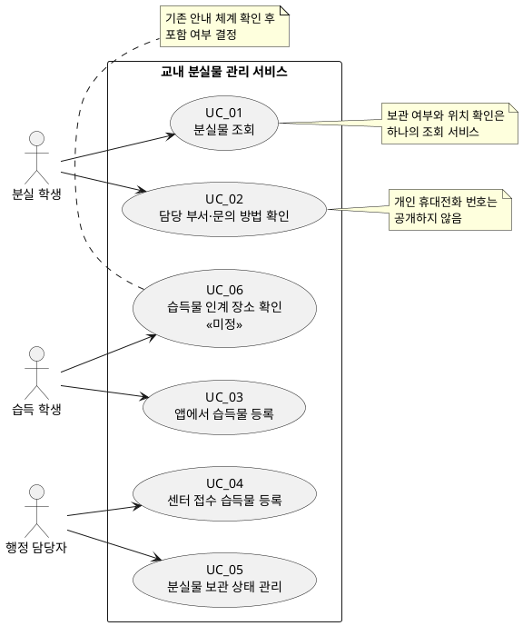

# 유스케이스 식별서(UD) v0.1

## 1. 식별 기준

유스케이스는 화면의 세부 기능이 아니라, 액터가 완료하려는 **하나의 서비스 단위**로 식별한다. 따라서 보관 여부와 보관 위치는 모두 분실 학생의 `분실물 조회`라는 하나의 서비스로 통합한다. 사진 검색·매칭·자동 알림, 개인 휴대전화 번호 공개, 실제 개인정보 및 학교 인증 연동은 범위에서 제외한다.

## 2. 액터 목록

|ID|액터|유형|역할 및 서비스와의 관계|상태|
|---|---|---|---|---|
|ACT_01|분실 학생|주요 액터|분실물을 찾기 위해 보관 여부·위치를 조회하고 담당 부서의 문의 방법을 확인한다.|확정|
|ACT_02|습득 학생|주요 액터|자신이 습득한 물품을 앱에서 직접 등록하고, 필요한 경우 물품을 맡길 장소를 확인한다.|등록 경로 확정; 장소 안내는 미정|
|ACT_03|행정 담당자|주요 액터|분실물 센터로 접수된 습득 물품을 등록하고 보관·인도 상태를 관리한다.|등록 경로 확정|
|ACT_04|정보보호 담당자|이해관계자|조회 화면의 공개 정보 범위를 검토한다. 현재 시스템 조작 유스케이스는 정의되지 않았다.|검토 역할|
|ACT_05|서비스 운영 책임자|이해관계자|등록 항목, 상태 변경 권한, 공개 정보 범위 등의 운영 정책을 결정한다. 현재 시스템 조작 유스케이스는 정의되지 않았다.|검토 역할|

## 3. Use Case 목록

|ID|Use Case|액터|사용자 목표|서비스 결과|관련 요구사항|상태|
|---|---|---|---|---|---|---|
|UC_01|분실물 조회|분실 학생|행정실을 방문하기 전에 찾는 물품의 보관 여부와 보관 위치를 확인한다.|보관 중·인도 완료 상태와 공개 가능한 보관 위치를 제공한다.|NEEDS_1, NEEDS_3, FR_00, FR_01|확정|
|UC_02|담당 부서·문의 방법 확인|분실 학생|추가 확인이 필요할 때 적절한 담당 부서에 문의한다.|담당 부서와 공식 문의 방법을 제공하며 개인 휴대전화 번호는 표시하지 않는다.|NEEDS_4, NEEDS_6, FR_04, Pol_01|확정|
|UC_03|앱에서 습득물 등록|습득 학생|주운 물품을 분실 학생이 조회할 수 있도록 앱에서 즉시 등록한다.|습득 학생이 조회에 사용할 습득물 정보를 직접 등록한다. 필수 입력 항목은 미확정이다.|NEEDS_2, FR_02, Pol_05|확정|
|UC_04|센터 접수 습득물 등록|행정 담당자|분실물 센터로 접수된 습득 물품을 조회할 수 있도록 등록한다.|행정 담당자가 센터에 접수된 습득물 정보를 등록한다. 필수 입력 항목은 미확정이다.|NEEDS_2, FR_02, Pol_05|확정|
|UC_05|분실물 보관 상태 관리|행정 담당자|보관 중인 물품과 인도된 물품을 구분해 관리한다.|물품 상태를 `보관 중` 또는 `인도 완료`로 기록·변경한다.|NEEDS_3, FR_03, Pol_02|확정|
|UC_06|습득물 인계 장소 확인|습득 학생|주운 물품을 맡길 장소를 안다.|습득물 인계 장소를 안내한다.|NEEDS_5, Pol_06|미정|

## 4. Use Case Description

### UC_01 — 분실물 조회

|항목|내용|
|---|---|
|ID / 이름|UC_01 / 분실물 조회|
|우선순위 / 상태|높음 / 확정|
|사용자와 목표|**분실 학생**이 분실물을 조회하여 보관 여부와 공개 가능한 보관 위치를 확인하고, 불필요한 행정실 방문을 줄인다.|
|관련 고객 요구·정책 ID|NEEDS_1, NEEDS_3, FR_00, FR_01, Pol_02, Pol_04|
|사전조건 / 시작 사건|사전조건: 서비스에 접근할 수 있다. 시작 사건: 분실 학생이 분실물을 찾기 위해 조회를 시작한다.|
|기본 흐름|1. 분실 학생이 조회 조건을 입력한다. 2. 시스템이 등록 물품 중 조건에 맞는 정보를 조회한다. 3. 시스템이 보관 상태(`보관 중`/`인도 완료`)와 공개 가능한 보관 위치를 표시한다. 4. 분실 학생이 조회 결과를 확인한다.|
|대안·예외 흐름|**A1 — 분기: 2 / 조건: 일치 물품 없음 / 대응:** 시스템은 일치하는 물품이 없음을 표시한다. **종료:** 물품 정보는 변경하지 않는다. **A2 — 분기: 1 / 조건: 조회 조건이 누락되었거나 허용되지 않음 / 대응:** 시스템은 수정이 필요한 조회 조건을 안내한다. **복귀:** 1단계. **[논의] A3 — 분기: 3 / 조건: 보관 위치 또는 일부 물품 정보가 공개 제한 대상 / 대응:** 제한된 정보는 비공개 또는 축약하여 표시한다. **복귀:** 4단계. 공개 범위와 축약 방식은 확정이 필요하다.|
|사후조건|**성공:** 조회 결과가 표시되며, 분실물 데이터는 변경되지 않는다. **실패·취소:** 결과를 표시하지 않거나 조회를 종료하며, 분실물 데이터와 사용자의 입력 외 정보는 보존·변경하지 않는다.|
|미확정 사항·고객 질문|[논의] 허용할 조회 조건(물품명, 분류, 습득일, 습득 장소 등)은 무엇인가? [논의] 조회 결과에 공개할 물품 정보와 보관 위치의 상세 수준은 어디까지인가?|

### UC_02 — 담당 부서·문의 방법 확인

|항목|내용|
|---|---|
|ID / 이름|UC_02 / 담당 부서·문의 방법 확인|
|우선순위 / 상태|높음 / 확정|
|사용자와 목표|**분실 학생**이 공식 담당 부서와 문의 방법을 확인하여 추가 확인이 필요할 때 안전한 경로로 문의한다.|
|관련 고객 요구·정책 ID|NEEDS_4, NEEDS_6, FR_04, NFR_00, Pol_01, Pol_04|
|사전조건 / 시작 사건|사전조건: 서비스에 접근할 수 있다. 시작 사건: 분실 학생이 담당 부서에 문의할 필요가 있어 문의 안내를 요청한다.|
|기본 흐름|1. 분실 학생이 문의 안내를 선택한다. 2. 시스템이 담당 부서와 공식 문의 방법을 표시한다. 3. 분실 학생이 안내를 확인한다.|
|대안·예외 흐름|**[논의] A1 — 분기: 2 / 조건: 담당 부서 또는 공식 문의 방법이 설정되지 않음 / 대응:** 시스템은 안내를 제공할 수 없음을 표시하고 운영 담당자에게 설정을 요청할 수 있는 경로를 제공한다. **종료:** 표시할 개인 연락처는 없다. **A2 — 분기: 2 / 조건: 표시 대상에 개인 휴대전화 번호가 포함됨 / 대응:** 시스템은 해당 번호를 표시하지 않는다. **복귀:** 공식 문의 방법만 표시한 뒤 3단계.|
|사후조건|**성공:** 공식 문의 방법이 표시되며, 개인 휴대전화 번호는 공개하지 않는다. **실패·취소:** 안내를 표시하지 않고 종료하며, 문의 정보와 분실물 데이터는 변경하지 않는다.|
|미확정 사항·고객 질문|[논의] 표시할 공식 채널은 무엇인가(대표 전화, 이메일, 방문 안내 등)? [논의] 담당 부서가 여러 곳일 때 선택·표시 기준은 무엇인가?|

### UC_03 — 앱에서 습득물 등록

|항목|내용|
|---|---|
|ID / 이름|UC_03 / 앱에서 습득물 등록|
|우선순위 / 상태|높음 / 확정|
|사용자와 목표|**습득 학생**이 자신이 주운 물품 정보를 앱에서 직접 등록하여 분실 학생이 물품의 보관 여부를 확인할 수 있게 한다.|
|관련 고객 요구·정책 ID|NEEDS_2, FR_02, Pol_00, Pol_05|
|사전조건 / 시작 사건|사전조건: 습득 학생이 서비스에 접근할 수 있고 등록 화면을 사용할 수 있다. 시작 사건: 습득 학생이 습득 물품을 앱에서 등록하기로 한다.|
|기본 흐름|1. 습득 학생이 앱에서 습득물 등록을 선택한다. 2. 시스템이 등록 입력 항목을 표시한다. 3. 습득 학생이 습득물 정보를 입력하고 등록을 요청한다. 4. 시스템이 입력값을 검증하고 물품 정보를 저장한다. 5. 시스템이 등록 결과를 표시한다.|
|대안·예외 흐름|**A1 — 분기: 4 / 조건: 필수 항목 누락 또는 입력 형식 오류 / 대응:** 시스템은 오류 항목을 안내한다. **복귀:** 3단계. **A2 — 분기: 3 또는 4 / 조건: 습득 학생이 등록을 취소함 / 대응:** 시스템은 저장하지 않고 등록을 종료한다. **종료:** 기존 등록 물품은 변경하지 않는다. **[논의] A3 — 분기: 4 / 조건: 기존 등록 물품과 중복될 가능성이 있음 / 대응:** 중복 확인·경고·등록 허용 여부를 결정해야 한다. **복귀 또는 종료:** 결정된 정책에 따른다. **[논의] A4 — 분기: 4 / 조건: 등록 직후 조회 공개 또는 행정 담당자 검토가 필요한지 불명확함 / 대응:** 공개·검토 상태 및 후속 처리를 정의해야 한다. **종료:** 확정 전에는 조회 공개 여부를 보장할 수 없다.|
|사후조건|**성공:** 습득물 정보가 가상 데이터로 저장되고 등록 결과가 표시된다. [논의] 저장 즉시 조회에 공개되는지 또는 검토 후 공개되는지는 미확정이다. **실패·취소:** 새 물품 정보는 저장하지 않으며, 기존 등록 물품은 보존한다.|
|미확정 사항·고객 질문|[논의] 앱 직접 등록의 필수·선택 입력 항목은 무엇인가? [논의] 학생 등록 건을 행정 담당자가 검토·승인·수정해야 하는가? [논의] 중복으로 의심되는 등록 건의 처리 기준은 무엇인가?|

### UC_04 — 센터 접수 습득물 등록

|항목|내용|
|---|---|
|ID / 이름|UC_04 / 센터 접수 습득물 등록|
|우선순위 / 상태|높음 / 확정|
|사용자와 목표|**행정 담당자**가 분실물 센터로 접수된 습득 물품을 등록하여 분실 학생이 보관 여부와 위치를 조회할 수 있게 한다.|
|관련 고객 요구·정책 ID|NEEDS_2, FR_02, Pol_00, Pol_05|
|사전조건 / 시작 사건|사전조건: 행정 담당자가 등록 권한을 보유하고, 습득 물품이 분실물 센터에 접수되어 있다. 시작 사건: 행정 담당자가 접수된 물품을 등록해야 한다.|
|기본 흐름|1. 행정 담당자가 센터 접수 습득물 등록을 선택한다. 2. 시스템이 등록 입력 항목을 표시한다. 3. 행정 담당자가 접수 물품 정보를 입력하고 등록을 요청한다. 4. 시스템이 입력값을 검증하고 물품 정보를 저장한다. 5. 시스템이 등록 결과를 표시한다.|
|대안·예외 흐름|**A1 — 분기: 4 / 조건: 필수 항목 누락 또는 입력 형식 오류 / 대응:** 시스템은 오류 항목을 안내한다. **복귀:** 3단계. **A2 — 분기: 3 또는 4 / 조건: 행정 담당자가 등록을 취소함 / 대응:** 시스템은 저장하지 않고 등록을 종료한다. **종료:** 기존 등록 물품은 변경하지 않는다. **[논의] A3 — 분기: 4 / 조건: 접수 물품이 앱 직접 등록 건 또는 기존 센터 등록 건과 중복될 가능성이 있음 / 대응:** 중복 식별·병합·별도 등록 기준을 정의해야 한다. **복귀 또는 종료:** 결정된 정책에 따른다.|
|사후조건|**성공:** 센터 접수 습득물 정보가 가상 데이터로 저장되고 등록 결과가 표시된다. **실패·취소:** 새 물품 정보는 저장하지 않으며, 기존 등록 물품은 보존한다.|
|미확정 사항·고객 질문|[논의] 센터 접수 등록에만 필요한 입력 항목(접수 일시, 접수 담당자 등)이 있는가? [논의] 앱 직접 등록 건과 동일 물품일 때 어떤 기준으로 중복을 판단·처리하는가?|

### UC_05 — 분실물 보관 상태 관리

|항목|내용|
|---|---|
|ID / 이름|UC_05 / 분실물 보관 상태 관리|
|우선순위 / 상태|높음 / 확정|
|사용자와 목표|**행정 담당자**가 물품의 보관 상태를 관리하여 보관 중인 물품과 인도 완료 물품을 정확히 구분하고, 분실 학생에게 최신 상태를 제공한다.|
|관련 고객 요구·정책 ID|NEEDS_3, FR_03, Pol_02, Pol_05|
|사전조건 / 시작 사건|사전조건: 관리 대상 물품이 등록되어 있고, 행정 담당자가 상태 관리 권한을 보유한다. 시작 사건: 물품이 보관되었거나 인도되어 상태 변경이 필요하다.|
|기본 흐름|1. 행정 담당자가 등록 물품을 선택한다. 2. 시스템이 현재 보관 상태를 표시한다. 3. 행정 담당자가 `보관 중` 또는 `인도 완료` 상태를 선택하고 변경을 요청한다. 4. 시스템이 상태 변경을 저장한다. 5. 시스템이 변경 결과를 표시한다.|
|대안·예외 흐름|**[논의] A1 — 분기: 1 또는 4 / 조건: 상태 변경 권한이 없음 / 대응:** 시스템은 변경을 거부하고 안내한다. **종료:** 기존 상태를 보존한다. 권한 부여 기준은 미확정이다. **A2 — 분기: 3 / 조건: 행정 담당자가 변경을 취소함 / 대응:** 시스템은 상태를 저장하지 않는다. **종료:** 기존 상태를 보존한다. **[논의] A3 — 분기: 4 / 조건: 이미 `인도 완료`인 물품을 다시 `보관 중`으로 변경해야 함 / 대응:** 정정 가능 여부, 사유 입력 및 이력 보존 방식을 정의해야 한다. **복귀 또는 종료:** 결정된 정책에 따른다.|
|사후조건|**성공:** 물품 상태가 `보관 중` 또는 `인도 완료`로 저장되고 이후 조회에 반영된다. **실패·취소:** 기존 상태를 보존한다. [논의] 상태 변경 이력의 보존 여부와 기간은 미확정이다.|
|미확정 사항·고객 질문|[논의] 상태 변경 권한자는 행정 담당자로 한정하는가? [논의] 상태 정정 시 사유 입력과 변경 이력을 보존해야 하는가?|

### UC_06 — 습득물 인계 장소 확인

|항목|내용|
|---|---|
|ID / 이름|UC_06 / 습득물 인계 장소 확인|
|우선순위 / 상태|미정 / 후보 유스케이스|
|사용자와 목표|**습득 학생**이 습득물을 어디에 맡겨야 하는지 확인하여 물품을 적절한 장소에 인계한다.|
|관련 고객 요구·정책 ID|NEEDS_5, Pol_06|
|사전조건 / 시작 사건|사전조건: 서비스에 접근할 수 있다. 시작 사건: 습득 학생이 물품을 맡길 장소를 확인하려 한다.|
|기본 흐름|1. 습득 학생이 습득물 인계 장소 안내를 선택한다. 2. 시스템이 인계 장소와 필요한 안내를 표시한다. 3. 습득 학생이 안내를 확인한다.|
|대안·예외 흐름|**[논의] A1 — 분기: 2 / 조건: 인계 장소 안내가 확정되지 않았거나 최신 정보가 아님 / 대응:** 기존 안내 체계 사용 여부와 서비스 내 표시 방식을 결정해야 한다. **종료:** 확정 전에는 안내 제공을 보장하지 않는다.|
|사후조건|**성공:** 습득 학생이 인계 장소 안내를 확인한다. **실패·취소:** 안내를 표시하지 않고 종료하며, 물품 및 등록 데이터는 변경하지 않는다.|
|미확정 사항·고객 질문|[논의] 이 안내를 이번 서비스에 포함할 것인가? [논의] 기존 오프라인·웹 안내가 있다면 서비스의 안내와 어떻게 구분·동기화할 것인가?|

## 5. Use Case Diagram

## 6. 고객 확인 사항

|ID|확인이 필요한 질문|영향 범위|
|---|---|---|
|Q_01|분실 학생은 어떤 검색 조건(예: 물품명, 분류, 습득일, 습득 장소)으로 분실물을 조회해야 하나요?|UC_01|
|Q_02|조회 결과에서 공개할 물품 정보와 보관 위치는 어느 수준까지 표시해야 하나요?|UC_01, UC_02|
|Q_03|앱 직접 등록과 센터 접수 등록에 각각 반드시 입력해야 하는 항목은 무엇인가요?|UC_03, UC_04|
|Q_04|습득 학생이 직접 등록한 정보를 행정 담당자가 검토·승인하거나 수정해야 하나요? 필요하다면 절차와 권한은 어떻게 되나요?|UC_03, UC_05|
|Q_05|누가 물품의 상태를 `인도 완료`로 변경할 수 있으며, 잘못 변경했을 때 어떤 방식으로 정정해야 하나요?|UC_05|
|Q_06|담당 부서명과 공식 문의 방법으로 어떤 채널(예: 대표 전화, 이메일, 방문 안내)을 표시해야 하나요?|UC_02|
|Q_07|습득물 인계 장소 안내를 이번 서비스에 포함할까요? 포함한다면 기존 안내와 어떻게 구분할까요?|UC_06|
